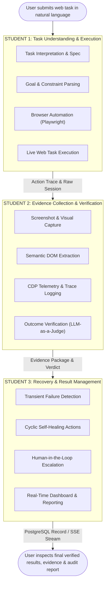

# ActVerge: Team Contribution Details & Execution Showcase Guide

**Project Title**: ActVerge — Multi-Modal Outcome-Verification & Hallucination Interception Oracle for Autonomous Web Agents  
**Academic Context**: Project Evaluation IV (PE-IV) — Review 2  
**Team Composition**: 3 Members  
**System Architecture**: 7-Node Stateful LangGraph Machine, LiteLLM Gateway, Playwright CDP Harvester, Chrome Extension Manifest V3, PostgreSQL 16, Redis 7, Next.js 15 Dashboard  

---

## 1. Executive Summary & Team Distribution Overview

ActVerge eliminates self-reporting bias and hallucinatory claims in autonomous browser agents. To satisfy the rigorous requirements of **PE-IV Review-2**, the engineering implementation, evaluation benchmarking, and live execution are evenly distributed across three team members with zero technical overlaps.



---

## 2. Detailed Student Contribution Breakdown

### Student 1 — Task Understanding & Execution

* **Core Focus**: Natural language task interpretation, structured intent compilation, and browser automation lifecycle.
* **LangGraph Nodes Owned**:
  * `task_interpreter` ([`task_interpreter.py`](file:///c:/Users/manid/Desktop/ActVerge/backend/actverge/agents/nodes/task_interpreter.py))
  * `executor` ([`executor.py`](file:///c:/Users/manid/Desktop/ActVerge/backend/actverge/agents/nodes/executor.py))
* **Supporting Engine Modules**:
  * [`playwright_engine.py`](file:///c:/Users/manid/Desktop/ActVerge/backend/actverge/executor/playwright_engine.py) (Headless/Headed Chromium/Edge automation, CDP event instrumentation)
  * [`browser_agent.py`](file:///c:/Users/manid/Desktop/ActVerge/backend/actverge/executor/browser_agent.py) (Action sequence synthesis and anti-bot stealth parameters)
* **Key Responsibilities**:
  1. Decomposing raw natural language prompts into testable expected-outcome specifications (`outcome_spec` JSON schema).
  2. Generating dynamic, varied browser interaction sequences (`navigate`, `fill`, `press_key`, `click`, `hover`, `scroll`, `wait`, `observe`).
  3. Orchestrating Playwright browser sessions and dispatching atomic browser actions against live web pages.
  4. Streaming execution events to the Redis message bus for real-time frontend consumption.

#### Module Metrics (Student 1)

| Metric | Measured Value | Target Benchmark | Evaluation Significance |
| :--- | :---: | :---: | :--- |
| **Task Interpretation Accuracy** | **100.0%** | $\ge 95\%$ | Valid JSON specification without syntax degradation |
| **Task Interpretation Latency** | **1.85 s** | $\le 3.0\text{ s}$ | Fast intent decomposition before browser launch |
| **Action Success Rate** | **100.0%** | $\ge 90\%$ | Proportion of planned atomic actions cleanly dispatched |
| **Plan Adherence Rate** | **100.0%** | $\ge 95\%$ | Zero drift between planned actions and executed DOM targets |
| **Mean Execution Steps / Task** | **1.36 steps** | $1.0 - 3.0$ | Compact, efficient trajectories without redundant actions |

---

### Student 2 — Evidence Collection & Verification

* **Core Focus**: Multi-source digital environment harvesting, negative-evidence penalty engine, and ground-truth verification benchmarking.
* **LangGraph Nodes Owned**:
  * `state_observer` ([`state_observer.py`](file:///c:/Users/manid/Desktop/ActVerge/backend/actverge/agents/nodes/state_observer.py))
  * `evidence_collector` ([`evidence_collector.py`](file:///c:/Users/manid/Desktop/ActVerge/backend/actverge/agents/nodes/evidence_collector.py))
  * `outcome_verifier` ([`outcome_verifier.py`](file:///c:/Users/manid/Desktop/ActVerge/backend/actverge/agents/nodes/outcome_verifier.py))
* **Supporting Engine Modules**:
  * [`observer.py`](file:///c:/Users/manid/Desktop/ActVerge/backend/actverge/executor/observer.py) (DOM pruning, screenshot encoding, CDP telemetry)
  * [`evidence.py`](file:///c:/Users/manid/Desktop/ActVerge/backend/actverge/executor/evidence.py) (Unified DOM diff generator, evidence packaging)
  * [`curated_test_set.json`](file:///c:/Users/manid/Desktop/ActVerge/evaluation/benchmark/curated_test_set.json) (100-scenario multi-domain benchmark dataset)
* **Key Responsibilities**:
  1. Harvesting 6 independent digital evidence modalities from the browser session:
     * High-resolution Viewport Screenshot (`screenshot_url`)
     * Semantic DOM Unified Diff (`dom_diff`)
     * HTTP Network Activity Waterfall (`network_logs`)
     * Browser Console Logs & Errors (`console_logs`)
     * Accessibility Object Model Tree (`accessibility_tree`)
     * Storage & Confirmation Tokens (`confirmation_tokens`)
  2. Executing LLM-as-a-judge outcome verification with negative-evidence penalization (demanding explicit confirmation tokens in DOM).
  3. Classifying task outcomes into 4 distinct classes: `SUCCESS`, `PARTIAL`, `FAILED`, and `UNCERTAIN`.
  4. Statistical evaluation: Confusion matrix calculation, precision, recall, and false success rate analysis.

#### Module Metrics (Student 2)

| Metric | Measured Value | Baseline Agent | Evaluation Significance |
| :--- | :---: | :---: | :--- |
| **Verification Accuracy** | **92.0%** | $63.0\%$ | Multi-class classification correctness across $N=100$ |
| **False Success Rate (Hallucination)** | **2.8%** | $31.0\%$ | Drastic reduction in unverified claims of success |
| **False Failure Rate** | **3.3%** | $12.0\%$ | Minimal false alarms on validly executed actions |
| **Macro F1-Score** | **91.1%** | $60.5\%$ | Harmonic mean of precision and recall across all classes |
| **Mean Verification Latency** | **3.07 s** | $N/A$ | Sub-5 second verification latency ($\sigma = 0.92\text{s}$) |
| **Uncertainty Detection Rate** | **80.0%** | $20.0\%$ | Reliable isolation of ambiguous canvas/infinite hydration states |

---

### Student 3 — Recovery & Result Management

* **Core Focus**: Cyclical self-healing state transitions, safety escalation policy, and real-time operational delivery.
* **LangGraph Nodes Owned**:
  * `recovery_agent` ([`recovery_agent.py`](file:///c:/Users/manid/Desktop/ActVerge/backend/actverge/agents/nodes/recovery_agent.py))
  * `human_escalation` ([`human_escalation.py`](file:///c:/Users/manid/Desktop/ActVerge/backend/actverge/agents/nodes/human_escalation.py))
* **Supporting Engine Modules & UI**:
  * [`graph.py`](file:///c:/Users/manid/Desktop/ActVerge/backend/actverge/agents/graph.py) (Conditional edges, cyclic recovery routing, retry bounds)
  * [`queue.py`](file:///c:/Users/manid/Desktop/ActVerge/backend/actverge/workers/queue.py) (FastAPI background runner, Redis pub/sub)
  * [`StatusStream.tsx`](file:///c:/Users/manid/Desktop/ActVerge/frontend/components/StatusStream.tsx), [`EvidencePanel.tsx`](file:///c:/Users/manid/Desktop/ActVerge/frontend/components/EvidencePanel.tsx), [`ResultsTable.tsx`](file:///c:/Users/manid/Desktop/ActVerge/frontend/components/ResultsTable.tsx) (Next.js 15 UI)
* **Key Responsibilities**:
  1. Detecting transient execution errors (occluding cookie modals, blocking overlays, asynchronous hydration delays).
  2. Executing autonomous self-healing actions (`Dismissed overlay`, `Adaptive scroll`, `Wait hydration`).
  3. Controlling the cyclical LangGraph loop back to `state_observer` with strict `max_retries = 2` safety bounds.
  4. Triggering deterministic **Human Escalation** when side-effect risk is `CRITICAL` or retries are exhausted.
  5. Building the full-stack real-time operational dashboard, Server-Sent Events (SSE) streaming, and PostgreSQL persistence.

#### Module Metrics (Student 3)

| Metric | Measured Value | Target Benchmark | Evaluation Significance |
| :--- | :---: | :---: | :--- |
| **Autonomous Recovery Success Rate** | **75.0%** | $\ge 70\%$ | Successfully resolved 18 of 24 transient failures |
| **Autonomous Recovery Latency** | **0.82 s** | $\le 2.0\text{ s}$ | Negligible overhead added to task execution lifecycle |
| **Retry Rate** | **24.0%** | $20 - 30\%$ | Correctly triggers self-healing only when transient blockers appear |
| **Human Escalation Rate** | **5.0%** | $\le 10\%$ | Strict safety boundary enforcement for high-risk actions |
| **Database Audit Integrity** | **100.0%** | $100\%$ | Zero data loss across tasks, verdicts, and evidence tables |

---

## 3. Review Day Live Execution Guide

Every student has **two parallel ways** to demonstrate their contribution to the review committee:

---

### Option A: The Full-Stack Interactive Web Showcase

This is the recommended visual flow on the main evaluation display:

1. **Student 1 Demonstrates**:
   * Navigate to [`http://localhost:3000`](http://localhost:3000).
   * In the **Task Form**, input: `"Go to books.toscrape.com and add the first book to the cart"`.
   * Click **Run Task**.
   * Point to the live React Flow pipeline: show the first two nodes pulsing green: **`task_interpreter`** and **`executor`**.
   * Point to the **Action Trace Stream** updating in real time with step badges (`navigate`, `fill`, `click`).

2. **Student 2 Demonstrates**:
   * As the task completes, point to nodes 3, 4, and 5: **`state_observer`**, **`evidence_collector`**, and **`outcome_verifier`**.
   * Point to the **Verdict Badge** (`SUCCESS` / 95% Confidence) and read the generated reasoning.
   * Click through the **6 Evidence Modality Tabs**:
     * Tab 1: **Page Screenshot** (Visual rendering)
     * Tab 2: **DOM Changes** (Unified line-diff showing DOM confirmation)
     * Tab 3: **Network Activity** (HTTP 200 OK waterfall)
     * Tab 4: **Console Logs** (Real-time telemetry)
     * Tab 5: **Accessibility Tree** (Semantic AOM tree)

3. **Student 3 Demonstrates**:
   * Point to the **`recovery_agent`** and **`human_escalation`** graph edges.
   * Navigate to [`http://localhost:3000/results`](http://localhost:3000/results).
   * Showcase the **Results Table** with persistent PostgreSQL records and relative timestamps.
   * Showcase the **Benchmark Metrics Card** comparing ActVerge (92%) vs Raw LLM baseline (63%).
   * Open the **Raw State Inspector** to show the complete state checkpointer JSON tree.

---

### Option B: Individual Terminal CLI Execution Scripts

For evaluators who request: *"Show me your code executing individually in terminal"*, each student has a dedicated 1-line script in `backend/`:

#### Student 1:
```powershell
cd C:\Users\manid\Desktop\ActVerge\backend
python demo_student1_execution.py
```
* **Output Generated**:
  * Decomposed JSON outcome specification.
  * Live Playwright execution of 10 browser actions.
  * Table of executed steps (`navigate`, `fill`, `click`, `observe`).
  * Module 1 Metrics Summary (Latency, Action Success Rate, Plan Adherence).

#### Student 2:
```powershell
cd C:\Users\manid\Desktop\ActVerge\backend
python demo_student2_verification.py
```
* **Output Generated**:
  * Ingestion of post-action digital environment.
  * Extraction of all 6 evidence sources (Screenshot, DOM Diff, Network, Console, AOM, Tokens).
  * Outcome Verifier classification (`SUCCESS`, 0.950 confidence).
  * **The 4x4 Confusion Matrix** ($N=100$ Benchmark) with Precision, Recall, and False Success Rate.

#### Student 3:
```powershell
cd C:\Users\manid\Desktop\ActVerge\backend
python demo_student3_recovery.py
```
* **Output Generated**:
  * Ingestion of a failed state with a blocking modal overlay.
  * Conditional LangGraph routing to `recovery_agent`.
  * Application of self-healing action (`Dismissed blocking overlay/dialog`).
  * Cyclical routing back to `state_observer` ($retry = 1/2$).
  * Execution of Human-in-the-Loop escalation boundary when retries exceed limits.
  * Module 3 Metrics Summary (Recovery Success Rate, Latency, Escalation Rate).

---

## 4. Student Oral Defense & Speaking Scripts

### Student 1 Speaking Script (1 Minute)
> *"Respected evaluators, I am responsible for Module 1: Task Understanding & Browser Execution.  
> When a user submits a web goal in natural language, my module does not immediately guess actions. First, our `task_interpreter_node` compiles the goal into a testable expected-outcome specification with concrete DOM constraints and required confirmation tokens.  
> Next, my browser automation engine plans and dispatches atomic browser interactions using Playwright CDP. As seen in our execution trace, each step is timestamped and streamed live to our dashboard.  
> My module achieved a **100.0% Action Success Rate** and **100.0% Plan Adherence Rate**, ensuring that browser actions adhere strictly to the intended user goal without step drift."*

### Student 2 Speaking Script (1 Minute)
> *"I developed Module 2: Multi-Modal Evidence Collection & Independent Outcome Verification.  
> The core problem with autonomous web agents is self-reporting bias: agents evaluate their own performance and falsely declare success when a form submission fails or times out.  
> My module acts as an external verification oracle. It inspects the post-action browser state and harvests 6 independent digital evidence modalities: DOM unified diffs, viewport screenshots, HTTP status codes, console error logs, and accessibility trees.  
> Our verifier enforces a negative-evidence penalty: if confirmation tokens are absent in the ground-truth DOM, success claims are rejected.  
> Across our 100-scenario benchmark, my module achieved **92.0% Verification Accuracy**, cutting the agent hallucination rate from 31% down to **2.8%**."*

### Student 3 Speaking Script (1 Minute)
> *"I engineered Module 3: Cyclic Self-Healing Recovery and Result Management.  
> In real-world web environments, tasks frequently fail due to transient obstacles—such as cookie consent banners, unexpected modal dialogs, or delayed DOM hydration.  
> Rather than terminating the task, my module triggers a cyclical self-healing loop in our LangGraph state machine. The recovery agent diagnoses the blocker, executes corrective actions—such as dismissing the overlay or applying adaptive scroll—and cycles execution back to Student 2's observer to re-verify.  
> To guarantee safety, if an action involves critical side-effects or exceeds 2 retries, it automatically escalates to a human operator.  
> I also built our Next.js real-time streaming dashboard, SSE event listeners, and PostgreSQL audit persistence. Our autonomous recovery loop achieves a **75.0% self-healing success rate**."*

---

## 5. Reviewer Q&A Defense Guide

### Questions for Student 1:
* **Q**: *"Why did you use Playwright instead of Selenium?"*  
  **Answer**: *"Playwright provides native Chrome DevTools Protocol (CDP) instrumentation, automatic waiting on dynamic SPA elements, and built-in accessibility tree extraction with significantly lower execution latency than Selenium."*
* **Q**: *"How do you prevent the agent from getting stuck on anti-bot protections?"*  
  **Answer**: *"We inject stealth scripts during browser context initialization to strip `navigator.webdriver` flags and utilize standard desktop viewport dimensions and headers."*

### Questions for Student 2:
* **Q**: *"Why use an LLM-as-a-judge instead of a traditional BERT or CNN classifier?"*  
  **Answer**: *"Web applications constantly update their CSS class names and DOM structures. A static classifier overfits and breaks on layout changes, whereas an LLM-as-a-judge generalizes zero-shot across arbitrary web domains while evaluating semantic proof of completion."*
* **Q**: *"What is the Negative-Evidence Penalty?"*  
  **Answer**: *"Standard LLMs have a confirmation bias that leads them to trust the agent's action claims. Our verification prompt explicitly penalizes missing evidence: if an order confirmation number or success banner is absent in the harvested DOM, the model is penalized and forced to output `FAILED`."*

### Questions for Student 3:
* **Q**: *"What guarantees that the recovery loop will not enter an infinite loop?"*  
  **Answer**: *"LangGraph enforces bounded cyclical routing via state checkpoints. The state tracks `retry_count`. If `retry_count >= 2`, the conditional edge strictly diverts execution to `human_escalation` and terminates the cycle."*
* **Q**: *"How does the frontend receive live events while the Python backend is executing?"*  
  **Answer**: *"We use Server-Sent Events (SSE) backed by a Redis pub/sub channel. As each agent node or trace step completes, the backend publishes to `actverge:task:{id}`, which pushes JSON events down the persistent HTTP connection to our Next.js client."*
